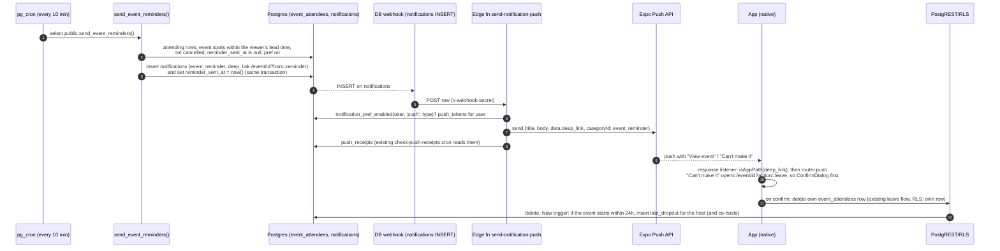
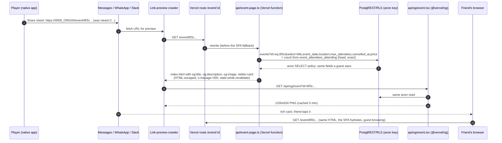
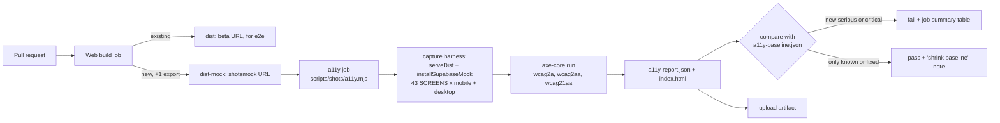

# vteam ideas: 2026-10-30

Three proposals for review. Reply in the run: `approve 1, 3` / `reject 2 because …`.

| # | Idea | Bucket | Size |
|---|---|---|---|
| 1 | Event reminders with one-tap "Can't make it" (and push for every notification) | Competitor gap (Spond, TeamSnap) | M |
| 2 | Share links that open anywhere, with rich previews | End-user experience | M |
| 3 | Accessibility check on every PR (axe-core over the shots harness) | Testing robustness | M |

Before screenshots are real captures of `main` @ `0f016e4` from `scripts/shots` (mocked Supabase, fixture people). Everything marked MOCK is a design mock with made-up people and data.

---

## 1. Event reminders with one-tap "Can't make it"

**Bucket:** competitor gap · **Size:** M · **Pitch:** Two hours before an event, everyone who's going gets a push: "Starts in 2 hours. Still coming?" If they can't make it, one tap releases the spot so the host can bring someone in from the waitlist.

### Why
- **No-shows cost spots.** Capacity and waitlists already exist (`event_capacity_enforcement`, the `waitlisted` status), but nothing nudges a player who's going and no longer plans to show. Hosts only find out at the court.
- **Push isn't wired up for notifications.** `notifications` rows (cheers, waitlist promotions, cancellations, join requests…) reach the in-app inbox only. Settings → Notifications labels push "coming soon" with the subtitle "Saved for when push is enabled" (`app/(app)/(tabs)/settings/notifications.tsx`). The only push sender is `send-chat-push`, and the app has no tap handler for pushes, so tapping one doesn't open the right screen.
- **Competitors:** [Spond](https://www.spond.com/news-and-blog/invites-and-reminders-spond-app/) sends automatic reminders 48h after an invite and 48h before an event, by push, SMS or email. TeamSnap lets organizers [send availability reminders](https://helpme.teamsnap.com/article/258-send-availability-reminders), and members can [set availability straight from the reminder email](https://helpme.teamsnap.com/article/95-set-availability-from-automatic-reminder-emails). vteam's version fits pickup play: one reminder for people who are going, with the release action in the notification itself.
- This fills in the roadmap's "Notifications: build infrastructure so triggers can be added incrementally". Push delivery is generic, so every existing and future notification type gets it.

### User stories
- As a player who's going, I get a reminder before the event, so I don't forget and I can drop out early enough for someone else to take my spot.
- As a player who can't make it, I release my spot from the notification in two taps, with a confirmation, instead of digging for "Leave event".
- As a host, I hear when someone drops out within 24h of start, so I can promote someone from the waitlist.
- As anyone, my existing push toggles (Waitlist, Cancellations, Cheers…) actually deliver push.

### Mocks
| Before: event page (real) | After: push (mock) | After: event page from reminder (mock) | After: release sheet (mock) |
|---|---|---|---|
|  |  |  |  |

| Before: notification settings (real) | After: reminders + live push (mock) |
|---|---|
|  |  |

### Design
- **Event page** `app/(app)/event/[id].tsx`: new `components/event/ReminderBanner.tsx` above the tabs when the viewer is `attending`, the event starts within their lead time, and the banner isn't dismissed for this event (or the page was opened with `?from=reminder`). "I'm in" dismisses it (device storage, per event). "Can't make it" runs the existing `useEventAttendance().leave` behind a `ConfirmDialog`, with copy that mentions the waitlist count from `hooks/event/derive.ts`.
- **Deep link** `routes.eventFrom(id, 'reminder')`. The push's "Can't make it" action opens `/event/<id>?action=leave`, which only opens the confirm dialog. Nothing is ever left without confirming. Add `routes.eventAction(id, 'leave')`. Runtime paths pass `isAppPath` as usual.
- **Push handling** `utils/pushNotifications.ts` + `app/_layout.tsx`: register an `event_reminder` notification category (actions `view` and `cant_make_it`) with `expo-notifications`, and add one `addNotificationResponseReceivedListener` that routes `data.deep_link` through `isAppPath` → `router.push(toRoute(path))`. This also makes chat pushes open their conversation.
- **Settings** `settings/notifications.tsx`: a "Reminders" card (on/off plus 1 hour / 2 hours / day before `Chip`s, stored as `user_settings.reminder_lead_minutes` via `useUserSettings`). Push toggles lose the "coming soon" label. New pref types `event_reminder` and `late_dropout` go in `NOTIFICATION_PREF_TYPES` / `NOTIFICATION_TYPE_LABELS` (`types/index.ts`, `constants/notifications.ts`).
- **Guests:** unaffected. Reminders are for attendees, and the banner never renders for guests. No new protected routes.
- **Surfaces:** native gets push with action buttons (iOS long-press, Android expand). Mobile and desktop web get the in-app inbox row and the banner (no web push in this scope). The banner buttons are 44pt, and on desktop it sits in `ScreenContainer` width.

### Backend


**Model changes**

| Object | Change | Notes (who can read/write) |
|---|---|---|
| `notifications_notification_type_check` | widen: add `event_reminder`, `late_dropout` | Dropped and re-added in one migration. Clients still never insert notifications. |
| `event_reminder_log (event_id, user_id, sent_at)` | new table, PK `(event_id, user_id)`, FKs cascade | Dedupe ledger. RLS on with **no policies**: only the definer function writes. |
| `user_settings.reminder_lead_minutes` | add `int not null default 120 check (reminder_lead_minutes in (60,120,1440))` | Existing owner-only RLS. Additive. |
| `public.send_event_reminders()` | new `security definer`, `set search_path = ''` | `revoke execute … from public, anon, authenticated`. Picks `attending` rows whose event starts in `(now(), now() + lead]`, isn't cancelled, has no log row, has `notification_pref_enabled(user,'in_app','event_reminder')`, and where the player joined before the window opened (no reminder right after joining). |
| `public.notify_host_on_late_dropout()` + `AFTER DELETE` trigger on `event_attendees` | new | When `OLD.status = 'attending'` and the event starts within 24h: inserts `late_dropout` for `created_by` + `event_cohosts`, honoring their prefs. |
| pg_cron `event-reminders` | `*/10 * * * *` → `select public.send_event_reminders()` | Runs on beta too (only e2ebot/e2ebuddy exist there, and beta has no edge functions, so no push). No `ALLOWED` entry needed. |
| Edge fn `send-notification-push` | new, `verify_jwt = false`, `requireWebhookAuth` | Same shape as `send-chat-push`: checks the `push` pref, reads `push_tokens`, sends to Expo with `data.deep_link` and `categoryId`, writes `push_receipts`, and dedupes webhook retries on `notification_id`. README table row. |
| Database webhook on `notifications` INSERT | manual Dashboard setup | Not captured by migrations. Document in `supabase/functions/README.md`. |

**Migration sketch** `supabase/migrations/20261101090000_event_reminders.sql`
```sql
alter table public.notifications drop constraint notifications_notification_type_check;
alter table public.notifications add constraint notifications_notification_type_check
  check (notification_type in (/* every existing type */, 'event_reminder', 'late_dropout'));
alter table public.user_settings add column if not exists reminder_lead_minutes int not null default 120
  check (reminder_lead_minutes in (60, 120, 1440));
create table public.event_reminder_log (
  event_id uuid not null references public.events(id) on delete cascade,
  user_id uuid not null references public.profiles(id) on delete cascade,
  sent_at timestamptz not null default now(),
  primary key (event_id, user_id));
alter table public.event_reminder_log enable row level security;  -- no policies
create function public.send_event_reminders() returns int language plpgsql security definer set search_path = '' as $$ … $$;
revoke execute on function public.send_event_reminders() from public, anon, authenticated;
create function public.notify_host_on_late_dropout() returns trigger … ;
create trigger trg_event_attendees_late_dropout after delete on public.event_attendees
  for each row execute function public.notify_host_on_late_dropout();
select cron.schedule('event-reminders', '*/10 * * * *', 'select public.send_event_reminders()');
```
**Down** `…_event_reminders.down.sql`
```sql
select cron.unschedule('event-reminders');
drop trigger if exists trg_event_attendees_late_dropout on public.event_attendees;
drop function if exists public.notify_host_on_late_dropout();
drop function if exists public.send_event_reminders();
drop table if exists public.event_reminder_log;
alter table public.user_settings drop column if exists reminder_lead_minutes;
delete from public.notifications where notification_type in ('event_reminder', 'late_dropout');
alter table public.notifications drop constraint notifications_notification_type_check;
alter table public.notifications add constraint notifications_notification_type_check check (notification_type in (/* previous list */));
```

**RLS expectations to add to `e2e/rls.spec.ts`**
- anon and the e2e account: `rpc('send_event_reminders')` is denied (permission error).
- the e2e account: `select` on `event_reminder_log` returns no rows, and `insert` is rejected.
- the e2e account: inserting a `notifications` row with type `event_reminder` is rejected (existing revoke still holds).
- the e2e account: updating its own `user_settings.reminder_lead_minutes` to `5` fails the check, and `120` succeeds (then restore). anon can't read `user_settings`.

### Test plan
- **Unit (Jest):** the lead-window helper (`utils/reminders.ts`: banner visible / hidden around the edges, already-started, cancelled), the push response handler (valid `deep_link` routed, invalid rejected, `cant_make_it` → `?action=leave`), the settings prefs patch for the new types, and the `ReminderBanner` render + confirm flow.
- **RLS:** the four expectations above (`api` shard).
- **e2e (`events` shard, `events.spec.ts`):** create an event starting in 90 min in `beforeAll` (`eventsFixtures.ts`) and RSVP e2ebot. Open `/event/<id>?from=reminder`, see the banner, tap "Can't make it", see the confirm, tap "Keep my spot", and confirm still attending. Then `?action=leave` → confirm → left. Teardown deletes it.
- **Shots:** add `event-reminder` (`/event/<id>?from=reminder`, an attending fixture event 2h out) and update `settings-notifications`. Add fixtures for `user_settings.reminder_lead_minutes`.
- **Manual (native):** a push with actions on an iOS + Android dev build. Edge function unit test with a mocked Expo API, mirroring `send-chat-push`.

### Acceptance criteria
- [ ] Attending players get one `event_reminder` (inbox + push when enabled) at their lead time (default 2h). Never twice, never for cancelled events, never right after joining.
- [ ] Push actions "View event" and "Can't make it" work on iOS and Android. "Can't make it" always confirms before leaving.
- [ ] Tapping any push (chat included) opens its deep link.
- [ ] Every notification type with push enabled is delivered by push. The "coming soon" label is gone.
- [ ] Hosts and co-hosts get `late_dropout` when an attending player leaves within 24h of start.
- [ ] Reminder lead time is editable in Settings → Notifications (1h / 2h / day before / off).
- [ ] Migration + `.down.sql` tested on beta via `apply_pr_migration`. Drift check green. `types/database.ts` regenerated.

### Risks, open questions, dependencies
- **Open:** should the push also go to people who are `waitlisted` ("you're #2, spots may open")? Proposed: not in v1.
- **Open:** should `late_dropout` auto-promote the first waitlisted player, or only notify the host? Today promotion is manual. Proposed: notify only.
- **Risk:** the Database Webhook is manual setup per project. Document it, and add a startup log line if `send-notification-push` hasn't run in 24h (or check via `push_receipts`).
- `migration-safety.mjs` may flag the constraint drop. It's a widen-in-place replacement and may need a `-- contract:` line or a script tweak.
- **Depends on / overlaps:** #4 / PR #100 (points: leaving forfeits points, which the copy mentions), PR #108 (rate limiting, nothing shared). Doesn't touch #15's friend notifications, but those get push for free.

---

## 2. Share links that open anywhere, with rich previews

**Bucket:** end-user experience · **Size:** M · **Pitch:** Sharing an event from the app sends a real `https://` link that opens for anyone (guest browsing already works) and shows a rich card in iMessage, WhatsApp and Slack: title, time, place, spots left.

### Why
- **Shares from the native app are broken for most recipients.** `components/event/EventHeaderActions.tsx` builds the link with `Linking.createURL(routes.event(id))`, which on native is `vteam://event/<id>`. Anyone without the app gets nothing, and Messages doesn't even make it a link. Pickup volleyball spreads through group chats, so this is the top of the funnel.
- **Web shares have no preview either.** `app/+html.tsx` has no `og:*` tags, and every route is the same static `index.html`, so a pasted link shows a bare URL (no title, time or image). Apple's [link-preview guidance](https://developer.apple.com/library/archive/technotes/tn2444/_index.html) says Messages builds the card from `og:title` / `og:image` on the HTML it fetches.
- Guest browsing (#17) already lets a recipient see the event and sign in to join, so this delivers it straight to them.

### User stories
- As a player, I share an event to my group chat and my friends see what, when, where and how many spots are left without opening anything.
- As a friend without the app, I tap the link, the event opens in my browser as a guest, and Join takes me to sign up and back.
- As a host, my cancelled event's old links say "Cancelled" instead of looking open.

### Mocks
| Before: what gets shared today (real link format, mock chat) | After: rich card (mock) |
|---|---|
|  |  |

**OG image (1200×630, mock)**


### Design
- **`constants/share.ts`**: `WEB_ORIGIN` (one constant, like the feedback email) and `shareUrl(path)` → `WEB_ORIGIN + path`. `EventHeaderActions` uses `shareUrl(routes.event(id))` on every platform (native share sheet, web copy link, Web Share). The message becomes `"<title>" · <Sat 4:00 PM> on vteam
<url>`.
- **Vercel** (the web host, `vercel.json` already has `api/tunnel.ts`): a route `{ "src": "/event/(?<id>[0-9a-f-]{36})/?$", "dest": "/api/event-page?id=$id" }` after `handle: filesystem` and before the SPA fallback.
  - `api/event-page.ts` reads the event with the **anon** key through PostgREST (only fields a guest already sees) and injects `<title>`, `og:title`, `og:description`, `og:image`, `og:url`, `twitter:card=summary_large_image` into `dist/index.html` (bundled via `functions.includeFiles`). All values are HTML-escaped. It returns the page with `cache-control: public, s-maxage=300, stale-while-revalidate=600`. Every visitor gets the same HTML (no user-agent sniffing), so humans get the normal SPA. Head-only tags don't change what hydrates, so no #418 risk.
  - `api/og/event.tsx` (Edge runtime, `@vercel/og`) renders the card from `theme.ts` tokens and the bundled Space Grotesk / Inter fonts.
  - States: cancelled → "Cancelled: <title>", ended → "Ended · <date>", missing or invalid id → the generic vteam card (the SPA shows its own not-found page).
- **Time zone:** format in the event's region zone (America/Chicago while we pilot), with one shared formatter also used by the app's share message.
- **Guests:** the link is a public event page. No new protected routes. `serve.json` already rewrites `/event/*` for CI.
- **Surfaces:** native (share sheet text + https URL), mobile web (Web Share), desktop web (copy link). Preview HTML is identical everywhere.
- **Out of scope / follow-up:** universal links / Android App Links so the https link opens the installed app (needs the Apple team ID, `associatedDomains`, `/.well-known/apple-app-site-association`, `assetlinks.json`). Club and tournament pages can reuse `api/event-page.ts` as a generic `share-page.ts` later.

### Backend
No Postgres change. This adds two Vercel functions that read with the public anon key.


| Object | Change | Notes (who can read/write) |
|---|---|---|
| `vercel.json` routes | add `/event/:id` → `/api/event-page` | Before the SPA fallback. |
| `api/event-page.ts` | new Vercel function (Node) | Reads `events` + the `event_attendees_attending` count with the anon key (existing anon SELECT policies). Writes nothing. |
| `api/og/event.tsx` | new Vercel Edge function | Same anon read. Returns a PNG. |
| `constants/share.ts` | new `WEB_ORIGIN`, `shareUrl()` | Client only. |
| Env | `SUPABASE_URL`, `SUPABASE_ANON_KEY` on Vercel (server-side copies of the public values) | No secrets. |

**RLS expectations:** none new. Add one line to `e2e/rls.spec.ts` asserting anon can `select title,event_date,location,max_attendees,cancelled_at,price` on `events` and count `event_attendees_attending` (`head: true`), so a future policy change can't silently break previews.

### Test plan
- **Unit:** `buildEventMeta(event, count, now)` (spots-left math, full/waitlist, cancelled, ended, missing, and escaping a title like `"><script>`), `shareUrl`, and the share message formatter. A handler test with a mocked `fetch` (PostgREST + index.html) that checks the injected tags and cache headers.
- **e2e (`other` shard):** the guest opening `/event/<id>` still works (existing `guest.spec.ts`). The CI static server doesn't run Vercel functions, so preview HTML is covered by the handler unit test.
- **Shots:** no visual change. Optionally add `og-event` as a capture of `api/og` rendered locally.
- **Manual:** paste a preview link into iMessage, WhatsApp, Slack and Discord, and check the [Facebook sharing debugger](https://developers.facebook.com/tools/debug/).

### Acceptance criteria
- [ ] Sharing from native, mobile web and desktop web produces `https://<WEB_ORIGIN>/event/<id>`. No `vteam://` in shared text.
- [ ] Pasting that URL in iMessage / WhatsApp / Slack shows the title, date/time, location and an image with spots left.
- [ ] Cancelled and ended events say so. Unknown ids get a generic card.
- [ ] Preview HTML exposes nothing beyond the anon-readable event fields. All values are escaped.
- [ ] Opening the link without the app shows the event as a guest. Join → sign in → back to the event.

### Risks, open questions, dependencies
- **Open:** what's the production web domain for `WEB_ORIGIN`? The repo only has `vteam.example.com` placeholders.
- **Open:** show the host's name or the attendee count on the card? Proposed: counts only, no names (privacy, #99).
- **Risk:** preview crawlers cache aggressively, so a full event can keep showing "4 spots left" in an old preview. Mitigation: word it as "4 of 16 spots left as of Sat 2 PM", or keep the time-stamped phrasing to the description only.
- **Depends on:** nothing in flight. Pairs well with #15 (friends) and PR #124 ("friends going").

---

## 3. Accessibility check on every PR

**Bucket:** testing robustness · **Size:** M · **Pitch:** Run axe-core (WCAG 2.1 AA) on all 43 `scripts/shots` screens, mobile and desktop, fully mocked, on every PR. Fail on new serious or critical violations, with today's issues written down in a baseline so the check can go in now.

### Why
- I ran a prototype today (`ideas/assets/2026-10-30/3-a11y-prototype.mjs`, axe-core 4.10 over the existing shots harness, mobile only). **Every one of the 43 screens has violations:**

| Rule | Impact | Where | Likely cause |
|---|---|---|---|
| `color-contrast` | serious | 469 nodes, 43 screens | `theme.colors.subtext #7A7699` is 3.9:1 on `card` and 4.3:1 on `background` (AA needs 4.5). `#8A86A9` gives 4.85 / 5.38. |
| `document-title` | serious | 43 screens | no `<title>` on web |
| `meta-viewport` | critical | 43 screens | `user-scalable=no` blocks pinch zoom (WCAG 1.4.4) |
| `aria-progressbar-name` | serious | 34 screens | an unlabelled `ActivityIndicator` (rendered as `role=progressbar`) |
| `label` | critical | settings → notifications (24 switches), host create (2) | toggles and inputs without an accessible name |
| `select-name` | critical | host create + edit (3 each) | `<select>` pickers without labels |
| `aria-required-attr` | critical | settings → badges | a switch with no `aria-checked` |

  Raw results: `ideas/assets/2026-10-30/3-axe-scan-main-0f016e4.json`.
- Accessibility work so far (#39, #43, the text-size guard test) is checked by hand or by one narrow unit test. Nothing stops a new unlabelled button or low-contrast token from landing.
- The shots harness (#128) already renders every screen with no network or secrets, so this costs one extra export and a short job.

### Design
- **`scripts/shots/a11y.mjs`**: reuses `serveDist`, `installSupabaseMock`, `SCREENS` and the settle logic from `capture.mjs`. Refactor `captureOne` to take an `onReady(page)` callback so screenshots and axe share one path. It injects pinned `axe-core` (devDependency, exact version), runs tags `wcag2a, wcag2aa, wcag21aa`, and writes `a11y-report.json` + `index.html` (rule, impact, screen, sample target, help URL).
- **Baseline** `scripts/shots/a11y-baseline.json`: `{ "<screen>": { "<rule>": <node count> } }`, keyed by screen + rule. RN-web class names are unstable, so selectors aren't used. **Fail** when a serious/critical rule shows up on a screen that doesn't have it in the baseline, or its node count goes above the baseline. **Pass with a note** when counts drop ("run `npm run a11y:baseline` to lock in the fix"). Minor/moderate findings are reported only.
- **CI** `.github/workflows/ci.yml`: the Web build job adds a second export against `https://shotsmock.supabase.co` (uploaded as `web-dist-mock`). A new `a11y` job (needs build-web, no secrets, no Supabase) runs `npm run a11y`, posts the table to `$GITHUB_STEP_SUMMARY` and uploads the report. It isn't in the e2e concurrency groups, since it never touches beta.
- **Scripts:** `npm run a11y` and `npm run a11y:baseline`. CLAUDE.md "Test layers" gets an "Accessibility (axe)" bullet.
- Native-only code isn't covered (same limit as shots). RN `accessibilityLabel`/`role` map to ARIA on web, so most label findings carry over to native.



**Job summary (mock)**


### Test plan
- `scripts/shots/a11y.test.mjs` (`node --test`, already in CI's unit job): baseline diff logic (new rule, count increase, count decrease, new screen, removed screen, minor ignored) and report rendering.
- Prove it locally: a branch that removes a button's `accessibilityLabel` fails the job, and the commit that restores it passes.
- New screens added to `SCREENS` are scanned automatically. A new screen enters the baseline only through `a11y:baseline`.

### Acceptance criteria
- [ ] `npm run a11y` scans every `SCREENS` entry at mobile and desktop sizes with no network, in under 4 min on CI.
- [ ] CI fails on a new serious/critical violation and names the rule, screen and help link in the job summary.
- [ ] `a11y-baseline.json` is committed with today's findings. Lowering a count never fails.
- [ ] HTML report uploaded as an artifact. CLAUDE.md test layers updated.
- [ ] Follow-up issues filed for the baseline findings (contrast token, `<title>`, viewport zoom, spinner label, notification-settings switch labels, host form pickers, badges switch), each shrinking the baseline.

### Risks, open questions, dependencies
- **Open:** CLAUDE.md asks for "no double-tap zoom" on mobile web. Keep that with `touch-action: manipulation` (already used) but drop `user-scalable=no` / `maximum-scale` so pinch zoom works? That clears the `meta-viewport` critical.
- **Open:** should `color-contrast` be fixed first (one token change, `subtext` → `#8A86A9`) so it can block from day one instead of sitting in the baseline?
- **Risk:** axe on react-native-web can be noisy (div-based widgets). The baseline and the serious/critical-only gate keep it low-friction.
- **Depends on:** #128 (shots harness, merged). Doesn't interact with open PRs except that PRs touching UI might trip it once merged, which is the point.
