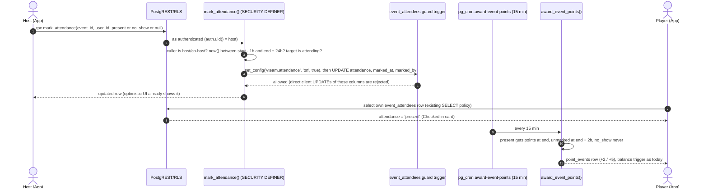
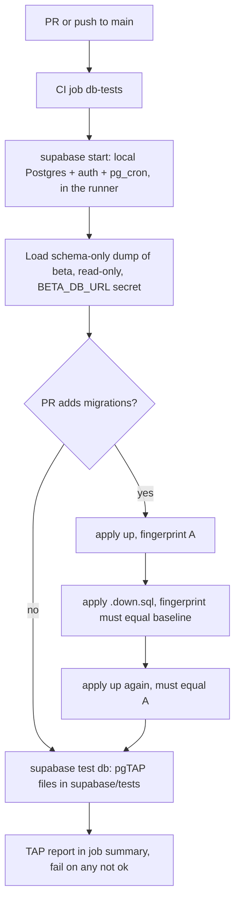

# vteam ideas: 2026-10-31

Three proposals for review. Reply in the run: `approve 1, 3` / `reject 2 because …`.

| # | Idea | Bucket | Size | Verdict |
|---|---|---|---|---|
| 1 | Host check-in: mark who showed up, and only they earn points | Competitor gap (Meetup, Reclub, TeamSnap) | M | Worth it; keep opt-in and private |
| 2 | Balanced teams: split by skill level and spread the setters | New feature (hosts) | S | Easy yes |
| 3 | Database logic tests: pgTAP + migration up/down round-trip in a throwaway Postgres | Testing robustness | M | Worth it, more so with #1 |

The "before" screenshot is a real capture of `main` @ `e95fe44` from `scripts/shots` (mocked Supabase, fixture people). Everything marked MOCK is a design mock with made-up people and data.

Checked against: every issue (#1–#146, open and closed), open PRs #102–#125, and `ideas/log.json`. None of these is planned or in flight. #4 (points, closed) and the roadmap's Teams section are what ideas 1 and 2 build on.

---

## 1. Host check-in: mark who showed up, and only they earn points

> **Revised at review and filed as [#151](https://github.com/bryanw121/vteam/issues/151):** everyone counts as present and hosts flag only the no-shows from the roster ⋯ menu ([mock](https://github.com/bryanw121/vteam/raw/ideas/ideas/assets/2026-10-31/1b-noshow.png)). The per-player check-in design below was dropped as too much host work.

**Bucket:** competitor gap · **Size:** M · **Pitch:** From an hour before start, hosts and co-hosts get a "Taking attendance" mode on the People tab: tap **Here** or **No-show** per player. Checked-in players get their points as soon as the game ends; no-shows get none.

### Why
- **Points reward RSVPs, not attendance.** `award_event_points()` (`supabase/migrations/20261028170000_points_ledger.sql`) gives 2 or 5 points to everyone whose status is still `attending` when the event ends. Someone who RSVPs and never shows gets the same points as the people who played, and points now buy something (100 points = 30 days ad-free, #103).
- **Hosts have no record of who came.** The late-dropout notice (#129) covers people who leave the RSVP; it can't see someone who simply doesn't turn up.
- **Competitors:**
  - [Meetup event check-in](https://help.meetup.com/hc/en-us/articles/9556581679245): check-in opens an hour before the event and stays open for 24 hours after it. Organizers swipe to mark people absent, can mark absentees "no show" in bulk, and attendance stats appear on the event's review page.
  - [Reclub for organizers](https://pickleball.reclub.co/for-organizers): lists "Mark paid / checked-in" and "Check participants" as RSVP features.
  - [TeamSnap](https://www.teamsnap.com/blog/how-to/availability-tips-how-to-lock-changes-and-track-attendance): owners lock availability before the event, then use it as the attendance record, with history and a CSV export.

  vteam's version is lighter: there are no penalties and nothing public. It fixes points, and gives each player their own reliability number.

### User stories
- As a host, I can mark each player **Here** or **No-show** from the People tab in two taps, starting an hour before the event and up to 24h after.
- As a host, **Mark the rest here** marks everyone not yet marked as Here, for a game where everyone showed up.
- As a player, I can see that I'm checked in and when my points will arrive.
- As a player, I can see my own record (showed up / no-shows / %) on my profile. Nobody else can see it.
- As a host who never takes attendance, nothing changes. Points arrive as they do today, after a short grace period.

### Mocks


The host's People tab during the check-in window (left). The player's Details card, plus the private stats card on Profile (right).

### Design
- **People tab** `components/event/PeopleTab.tsx`: when `isHostOrCohost` and now is between start − 1h and end + 24h, render the new `components/event/AttendancePanel.tsx` above "Going": summary counts, a progress bar and the window end. Each roster row gets a two-button segmented control, **Here** and **No-show**: 44pt targets, `accessibilityRole="radio"` with `aria-checked`, and tapping the selected button again clears it. Team grouping is hidden while the panel is open, and **Done** collapses it. Guests (`event_guests`) get the same control, with no points. This mirrors Meetup, where guests inherit the attendee's status.
- **Hook** `hooks/event/useEventAttendance.ts` adds `markAttendance(userId, value)`, a `useMutation` that optimistically updates `eventKeys.detail(id)` through `setQueryData` and rolls back on error. Attendance columns come with the roster select. Hosts see every row; a player sees only their own (enforced by the trigger plus the select below).
- **Player card** `components/event/DetailsTab.tsx`: a "You're checked in" card when the viewer's own `attendance = 'present'`. It is never shown to others.
- **Profile** `app/(app)/(tabs)/(main)/profile/index.tsx`: a "Your stats" card from the new RPC `get_my_attendance_stats()` (counts only events where the host took attendance). It is not on `profile/[id].tsx`, so other people never see it.
- **Routes:** none new. Guests never see the panel (host-only). Surfaces: on native, the rows are 44pt with haptics on mark. On mobile web, the same. On desktop web, the panel sits in `ScreenContainer` width, buttons have hover states, and the segmented control is reachable by keyboard (arrow keys move within a row).
- **Copy** goes in `constants/copy.ts` (`ATTENDANCE_*`).

### Backend




**Model changes**

| Object | Change | Notes (who can read / write) |
|---|---|---|
| `event_attendees.attendance` | new `text null`, CHECK in (`present`, `no_show`) | Read: same as the row today. The app shows it only to hosts/co-hosts and the player. Write: only through `mark_attendance` (guard trigger). |
| `event_attendees.attendance_marked_at` / `_marked_by` | new `timestamptz null` / `uuid null → profiles` | Set by the RPC only. |
| `event_guests.attendance` | new `text null`, same CHECK | Host-only write via the RPC (`p_guest_id` variant). |
| `guard_attendance_columns()` + BEFORE UPDATE trigger on both tables | new | Raises if any attendance column changes while `current_setting('vteam.attendance', true)` is not `'on'`. |
| `mark_attendance(p_event_id, p_user_id, p_value)` / `mark_guest_attendance(p_guest_id, p_value)` | new SECURITY DEFINER, `search_path = ''` | EXECUTE: `authenticated` only. Checks host or `event_cohosts`, the window, and that the target is `attending`. |
| `get_my_attendance_stats()` | new SECURITY DEFINER, STABLE | Returns `{present, no_show}` for `auth.uid()` only. |
| `award_event_points()` | replaced (same signature) | Adds `and coalesce(ea.attendance, '') <> 'no_show'`; unmarked rows wait for `end + interval '2 hours'`; `present` rows award at end. |

**Migration sketch** (`<ts>_event_attendance.sql`, additive):
```sql
alter table public.event_attendees
  add column attendance text check (attendance in ('present','no_show')),
  add column attendance_marked_at timestamptz,
  add column attendance_marked_by uuid references public.profiles(id) on delete set null;
alter table public.event_guests add column attendance text check (attendance in ('present','no_show'));

create function public.guard_attendance_columns() returns trigger language plpgsql set search_path = '' as $$
begin
  if (new.attendance is distinct from old.attendance)
     and coalesce(current_setting('vteam.attendance', true), '') <> 'on' then
    raise exception 'attendance is set with mark_attendance()' using errcode = '42501';
  end if;
  return new;
end $$;
create trigger event_attendees_guard_attendance before update on public.event_attendees
  for each row execute function public.guard_attendance_columns();
-- same trigger on event_guests

create function public.mark_attendance(p_event_id uuid, p_user_id uuid, p_value text) returns void
  language plpgsql security definer set search_path = '' as $$ … $$;
revoke execute on function public.mark_attendance(uuid, uuid, text) from public, anon;
grant execute on function public.mark_attendance(uuid, uuid, text) to authenticated;
-- create or replace function public.award_event_points() … (no_show excluded, unmarked + 2h)
```
**Down** (`.down.sql`): restore the previous `award_event_points()` body verbatim, drop the two triggers, the three functions and the guard function, then drop the four columns.

**RLS expectations for `e2e/rls.spec.ts`:**
- `anon.rpc('mark_attendance')` → permission denied.
- e2ebot as a non-host calling `mark_attendance` on someone else's event → `42501`.
- A direct `update event_attendees set attendance = 'present'` on e2ebot's own row → rejected by the guard.
- `get_my_attendance_stats` as anon → denied; as e2ebot → returns only its own counts.

### Test plan
- **Unit:** `hooks/event/derive.ts` attendance summary (`here / no-show / unmarked`), window open/closed at the edges (start − 1h, end + 24h), and the PeopleTab panel showing for host and co-host only.
- **RLS:** the four cases above (`api` shard).
- **e2e:** `e2e/attendance.spec.ts` (signed-in shard). The fixture creates an `[e2e]` event starting in 30 minutes with e2ebot as host and e2ebuddy attending. The spec marks e2ebuddy Here, reloads to confirm it persisted, clears the mark, then marks No-show. Cleanup in `afterAll`. Points timing is covered by idea 3's pgTAP tests, since e2e can't wait for an event to end.
- **Shots:** add `event-people-checkin` (host, fixture event inside its window) and `event-details-checked-in` to `scripts/shots/screens.mjs`, with fixture rows carrying `attendance`.

### Acceptance criteria
- [ ] Hosts and co-hosts see **Taking attendance** on the People tab from start − 1h to end + 24h; nobody else does
- [ ] Each attending player and guest row has **Here** / **No-show** (44pt, radio semantics); tapping the selected one clears it
- [ ] **Mark the rest here** marks every unmarked row present in one call
- [ ] `mark_attendance` rejects anon, non-hosts, rows that aren't `attending`, and calls outside the window (`42501` / clear message)
- [ ] A direct client UPDATE of any attendance column is rejected by the guard trigger
- [ ] `award_event_points()`: `present` → points once the event ends; unmarked → at end + 2h; `no_show` → never; still idempotent
- [ ] A checked-in player sees "You're checked in" on Details; nobody else sees another player's mark outside the host view
- [ ] Profile shows the viewer's own showed-up / no-show / % from `get_my_attendance_stats()`; `profile/[id]` does not
- [ ] Migration + exact `.down.sql`; `types/database.ts` regenerated; RLS spec, e2e spec and shots screens added

### Pros and cons
| Pros | Cons |
|---|---|
| Points start meaning attendance, which matters now that 100 points buys 30 days ad-free (#103) | Extra work for hosts at the court; many will skip it, so the data will be patchy |
| Hosts get a real record of who came, which the late-dropout notice (#129) can't see | Unmarked players wait 2h longer for points than today |
| Proven pattern: Meetup, Reclub and TeamSnap all have check-in or attendance | A host's mistaken No-show silently costs a player points; there is no appeal flow in v1 |
| Opt-in for hosts: if nobody takes attendance, players still get points, just 2h later | Adds schema, a guard trigger and a points-rule change: the largest of the three to build and review |
| Unlocks later features (host reliability view, no-show limits) on data we'd otherwise never have | Social risk: players may feel watched, even though the record is private |

**Verdict:** Worth it: points now buy something, so paying no-shows is a real bug. Keep it opt-in and private to limit the downsides.

### Size, risks, open questions
- **Size M:** one migration, one RPC set, one panel component, a profile card.
- **Risk:** the unmarked grace period delays points by 2h for hosts who never take attendance. Alternative: award at end as today, and write a negative `no_show_reversal` ledger row for a no-show marked later (bounded by the balance CHECK).
- **Open questions:**
  - Is 2h the right grace period?
  - Should hosts eventually see a player's reliability % when approving join requests? (Not in v1: no one sees anyone else's record.)
  - Should a no-show remove the player's cheers eligibility for that event?
- **Dependencies:** #4/#100 (points, merged), #129 (late-dropout notices, merged). It touches `PeopleTab.tsx`, which #124 (friends going) also edits, so land #124 first or rebase.

---

## 2. Balanced teams: split by skill level and spread the setters

**Bucket:** new feature · **Size:** S · **Pitch:** Next to **Randomize**, hosts get a **Random | Balanced** toggle. Balanced splits players so team skill totals are as close as possible, puts one setter on each team where possible, and keeps pinned players where they are. It's client-only, with no schema change.

### Why
- **Random splits are often lopsided, and every roster already has the data to avoid it.** Profiles carry `skill_level` (D → AA+) and `position[]`, and the roster already shows them ("A · OH"). `randomizeAssignments` (`hooks/event/derive.ts`) ignores both.
- **Real example from the shots fixture:**
  - One random draw put AA+, A, A, BB, BB, BB and both setters on Purple. Red got A, B, B, B, C, a guest and no setter.
  - On a 1–6 scale (D = 1 … AA+ = 6) that is 28 vs 20.
  - Balanced gives 24 vs 24 with one setter each (mock below).
- **Hosts fix this by hand today** by dragging players (`useTeamDrag`), one by one.
- **Builds on the roadmap's Teams section** ("randomized by default, host can pin"), which is shipped. This is a new direction on it: random stays the default.

### User stories
- As a host, I can pick **Balanced** and get even teams in one tap, then adjust by dragging as today.
- As a host, my pins are respected in both modes.
- As a host, I can see each team's average level and setter count, so I can tell at a glance whether the split is fair.
- As a player, nothing changes except fairer games. Players don't see the team-builder controls.

### Mocks


Left: a real capture of `main` (People tab, Randomize). Right: MOCK of Balanced with the same fixture players.

### Design
- **Algorithm**, a pure function `balanceAssignments(players, assignments, numTeams)` in `hooks/event/derive.ts`, next to `randomizeAssignments`. It takes the same divisibility and pin checks (shared helper) and returns the same `RandomizeResult` shape.
  1. **Score:** D = 1, C = 2, B = 3, BB = 4, A = 5, AA+ = 6. Unknown (guests, blank profiles) gets the mean of the known players.
  2. **Seed with pins:** team totals and setter counts start from the pinned players.
  3. **Spread setters:** unpinned players with `setter` in `position` go to the team with the fewest setters and room, with the lower total as tie-break.
  4. **Fill the rest:** sort by score (descending, random tie-break) and greedily assign each player to the team with the lowest total that has room.
  5. **Improve:** one pass of pairwise swaps between teams that reduces the max−min total, for at most 50 iterations.

  Deterministic given `random`, so it is unit-testable like the existing function.
- **Hook** `hooks/event/useEventTeams.ts`: `mode: 'random' | 'balanced'` state, plus `shuffleTeams()`, which calls the matching function. The last mode is remembered per device (localStorage on web, AsyncStorage on native, wrapped in try/catch) under `vteam.teamMode`.
- **UI** `components/event/PeopleTab.tsx`: a `Chip`-style two-option segmented control under "Going", host and co-host only. The button label follows the mode (**Randomize** / **Balance**). Team headers get `avg BB` and `1 setter` chips (`theme.colors.primarySoft` / `cool`), shown only when at least half the players have a level. Copy goes in `constants/copy.ts`.
- **Guests:** no change (they never see host controls).
- **Surfaces:** native and mobile web use 44pt segments. Desktop web has hover and keyboard focus on the segments. No layout change at ≥768px.
- **Backend:** none. Saved teams use the existing `team_number` / `team_pinned` columns.

### Test plan
- **Unit** (`__tests__/derive.balance.test.ts`):
  - With the shots fixture roster, the totals differ by ≤ 1 tier point and each team gets one setter.
  - Pinned players never move.
  - Unequal splits and over-pinned teams return the same errors as `randomizeAssignments`.
  - All-unknown levels fall back to an even random split.
  - Seeded `random` gives deterministic output.
- **e2e:** extend `e2e/events.spec.ts` (signed-in shard). As host, switch to Balanced, press Balance, and assert both team headers show a setter chip. Reuses the existing fixture event.
- **Shots:** add `event-people-balanced` to `scripts/shots/screens.mjs`, with an action to tap the Balanced segment and Balance.

### Acceptance criteria
- [ ] Hosts and co-hosts see a **Random / Balanced** control under Going; the action button reads **Randomize** or **Balance**
- [ ] Balanced: team skill totals within 1 tier point when the roster allows it, and one setter per team while setters ≥ teams
- [ ] Pinned players never move; unequal-split and over-pinned errors match Randomize
- [ ] Unknown levels (guests, blank profiles) count as the roster's mean; all-unknown falls back to a random even split
- [ ] Team headers show `avg <tier>` and `<n> setter(s)` chips when at least half the players have a level
- [ ] Last mode is remembered per device (try/catch storage); Save writes the same `team_number` / `team_pinned` as today
- [ ] Unit tests for `balanceAssignments`, e2e step in `events.spec.ts`, `event-people-balanced` in shots

### Pros and cons
| Pros | Cons |
|---|---|
| Fixes a visible problem in one tap: the fixture roster splits 28 vs 20 today and 24 vs 24 balanced | Only as good as self-reported levels; a sandbagger or a blank profile skews it |
| Uses data the app already has (`skill_level`, `position[]`); no schema, RLS or migration | Guests and players without a level count as average, which hides real gaps |
| Smallest of the three: one pure, unit-testable function plus a toggle | Can feel like labelling people when team chips show averages |
| Random stays the default, so hosts who like random lose nothing | Setter-only position logic may not match how every host thinks about balance |
| Fairer games make open play more fun, which helps retention | Another control in an already busy host area of `PeopleTab.tsx` |

**Verdict:** Easy yes: cheap, no backend, and hosts can still drag or pin to override.

### Size, risks, open questions
- **Size S:** one pure function, a mode toggle and two chips.
- **Risk:** self-reported levels can be wrong. Hosts can still drag and pin, and the chips make a bad split visible.
- **Open questions:**
  - Should we balance other positions too (libero, middle)? v1 does setters only.
  - Should the host's chosen mode be stored per event, so co-hosts see the same mode? v1 stores it per device.
- **Dependencies:** none. It touches `PeopleTab.tsx` like #124 and idea 1, so sequence those.

---

## 3. Database logic tests: pgTAP + migration up/down round-trip in a throwaway Postgres

**Bucket:** testing robustness · **Size:** M · **Pitch:** A new CI job starts a local Supabase stack in the runner, loads beta's schema, and runs pgTAP tests for the SQL that runs vteam's server-side logic. For a PR that adds migrations, it also proves that up → down → up returns exactly to the same schema.

### Why
- **About 25 Postgres functions hold the business rules,** and none of them is tested on its own:
  - **Scheduled jobs:** `award_event_points`, `send_event_reminders`, `send_kudos_reminders`, `rollup_app_events`, `ingest_schelagg_feed`.
  - **Rules enforced by triggers:** `enforce_event_capacity`, `enforce_event_join_approval`, `notify_on_waitlist_promoted`, `notify_host_on_late_dropout`, `apply_point_event`.
  - **Points spending:** `redeem_ad_free`.
- **The RLS spec can't reach this logic.** It (`e2e/rls.spec.ts`, 16 tests) runs against shared beta, read-only by design: "every insert is one RLS must reject". So it can't create an event in the past, run the award job, and check the ledger.
- **`.down.sql` files are never executed** until a PR is closed (`beta_meta.rollback_pr`). A wrong down script only shows up when it is needed, on beta.
- **Time-dependent rules are the riskiest:**
  - points at `event_date + duration`
  - reminders at the lead time
  - the 12h staleness guard in the Schelagg ingest

  pgTAP inside a transaction can create rows dated anywhere and roll everything back.

### Design




- **CI job** `db-tests` in `.github/workflows/ci.yml`. It runs on every PR and push to `main`, in parallel with `unit`, and needs no e2e concurrency group because it never touches a shared project.
  1. `supabase/setup-cli` (pinned), then `supabase start -x studio,imgproxy,inbucket,edge-runtime,logflare,vector`. This starts only Postgres and Auth, about 60–90s with the Docker layer cache.
  2. `supabase db dump --db-url "$BETA_DB_URL" --schema public,beta_meta` (schema only, no data) loads into the local DB, then `scripts/db-seed-reference.sql` adds the reference rows (`tags`, `major_cities`, `app_config`), copied from beta with `--data-only --table`.
  3. If beta's ledger already has this PR's migrations, run their `.down.sql` locally first, so the baseline is `main`'s schema.
  4. **Round-trip** (`scripts/migration-roundtrip.mjs`, a small sibling to `migration-safety.mjs`):
     - For each new migration in the PR, apply up and take `schema_fingerprint()` as A.
     - Apply down. The fingerprint must equal the baseline.
     - Apply up again. The fingerprint must equal A.
     - On failure, print the differing keys (the same diff code as `schema-drift.mjs`, factored into `scripts/lib/fingerprintDiff.mjs`).
  5. `supabase test db` runs `supabase/tests/*.test.sql`. Output goes to the job summary.
- **Tests** (each file is `begin; select plan(n); … select * from finish(); rollback;`), with helpers in `supabase/tests/_helpers.sql` (`tests.create_user(name)`, `tests.create_event(host, starts_at, duration, tags)`, `tests.as_user(id)` sets `request.jwt.claims` and `role authenticated`):

  | File | Asserts |
  |---|---|
  | `points.test.sql` | ended event → 2 points; Tournament tag → 5; second run inserts nothing (idempotent); someone who left or joined after the end → 0; cancelled event → 0 |
  | `ad_free.test.sql` | `redeem_ad_free` with 99 points fails (balance CHECK); with 100 it gives 30 days, and a second redeem extends from the current expiry |
  | `capacity.test.sql` | full event → next join is `waitlisted`; a leave promotes the oldest waitlisted player and inserts a `waitlist_promoted` notification |
  | `reminders.test.sql` | `send_event_reminders` sends once per player per event at the lead time (`event_reminder_log`); a second run sends nothing; `late_dropout` fires only within 24h |
  | `rollup.test.sql` | `rollup_app_events` writes per-day totals with distinct `people`; re-run is idempotent |
  | `schelagg.test.sql` | the mapping part of `ingest_schelagg_feed`, split into a pure `ingest_schelagg_rows(jsonb)` (one small expand migration) so a fixture feed can be fed in without `http`: keeps only volleyball/austin, upserts, and deletes cancelled upcoming rows only when the feed has matches |
- **Secret:** `BETA_DB_URL` (beta's Postgres connection string, as a role `ci_dump` that can connect and read the schema, with SELECT only on the three reference tables). Beta has no real user data. Live is never contacted.
- **Docs:** a "Test layers" bullet in `CLAUDE.md`. The rule: a PR that changes a SQL function adds or updates its `.test.sql`.

### Backend / model changes
| Object | Change | Notes |
|---|---|---|
| beta role `ci_dump` | new (beta only, via `apply_pr_migration`) | Can connect and read schema plus 3 reference tables. Used only by `db-tests`. |
| `ingest_schelagg_rows(jsonb)` | new function (live and beta); `ingest_schelagg_feed()` replaced to call it | No behavior change. EXECUTE stays revoked from clients. |
| `supabase/tests/*` | new | Never applied to any project. |

The `ci_dump` role belongs only on beta. It goes in `ALLOWED` in `schema-drift.mjs` with a one-line reason; this is the one place a permanent difference is justified, and it is open question 1 below.

### Test plan
- **Self-test:** a deliberate wrong `.down.sql` in a test PR makes the round-trip fail with the missing key named. `migration-roundtrip.test.mjs` (node:test) covers the ordering and diff output with stubbed fingerprints.
- **Flake resistance:** no network after the dump, and no shared state. If the dump step fails on network, it is retried once through `withNetworkRetry`.
- **CI time:** expected +2–3 min wall clock, in parallel with `unit`, so it doesn't lengthen the critical path (e2e).

### Acceptance criteria
- [ ] New `db-tests` job runs on every PR and push to `main` without touching live or writing to beta
- [ ] It starts a local Supabase stack, loads beta's schema-only dump plus reference rows, and records a baseline fingerprint
- [ ] For each new migration in the PR: up → down → up, with the fingerprint after down equal to the baseline and after the second up equal to the first; failures name the differing keys
- [ ] `supabase test db` runs `supabase/tests/*.test.sql`; any `not ok` fails the job and the TAP output lands in the job summary
- [ ] Tests cover points award, ad-free redeem, capacity/waitlist, reminders + late dropout, metrics rollup and the Schelagg row mapping
- [ ] `ingest_schelagg_feed()` mapping split into `ingest_schelagg_rows(jsonb)` with no behavior change (expand migration + down)
- [ ] `CLAUDE.md` Test layers documents the job and the rule that a SQL function change updates its test

### Pros and cons
| Pros | Cons |
|---|---|
| Covers the riskiest untested code: the SQL that pays points, sends reminders and runs the waitlist | Adds 2–3 min of CI and a Docker-based job that can break when the Supabase CLI updates |
| Catches a broken `.down.sql` before a PR is closed, not when beta needs it | Needs a new beta DB secret and a `ci_dump` role, which is a small new piece of infra to own |
| Runs on a throwaway local database, so no beta contention and no live access | Beta's schema dump includes other open PRs' changes, so the baseline isn't exactly `main` |
| Makes ideas like #1 safer: the points change ships with a test that dates events in the past | Contributors have to write pgTAP SQL, a new skill for this repo |
| Runs in parallel with the unit tests, so it doesn't slow the critical path | Doesn't help players directly |

**Verdict:** Worth it as the server rules keep growing; it pays off most if idea 1 is approved too.

### Size, risks, open questions
- **Size M.**
- **Risks:**
  - Supabase CLI start time on GitHub runners: cache Docker images with `actions/cache` on the CLI version.
  - Beta dumps include other open PRs' pending changes. Acceptable: CI already treats beta as "main + open PRs".
  - pg_cron jobs exist in the dump but don't fire within a test transaction.
- **Open questions:**
  1. Should `ci_dump` live in a beta-only migration listed in `ALLOWED`, or be created by hand once and documented under "Not captured by migrations"? The second keeps drift clean.
  2. Should the tests run against live's schema instead? That needs a live DB URL in CI, which this proposal avoids.
- **Dependencies:** #131/#147 established the pattern of a CI job with its own baseline. #132 is merged, so `send_event_reminders` is testable now. Idea 1's points change would ship with a `points.test.sql` update.
